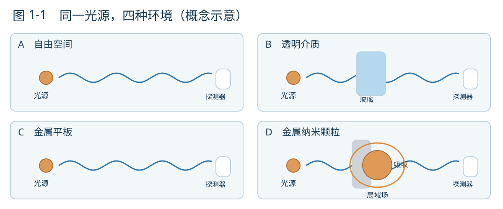
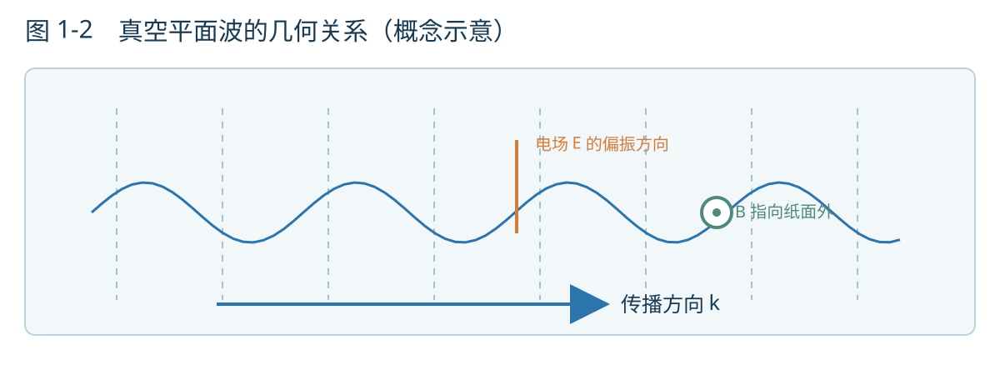
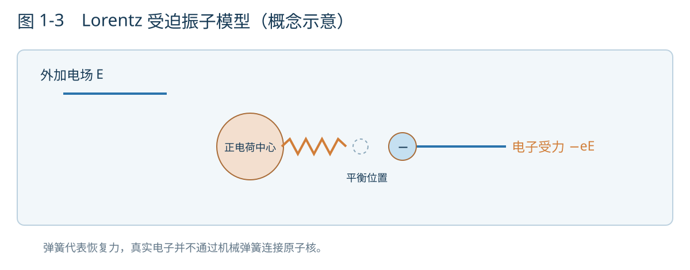
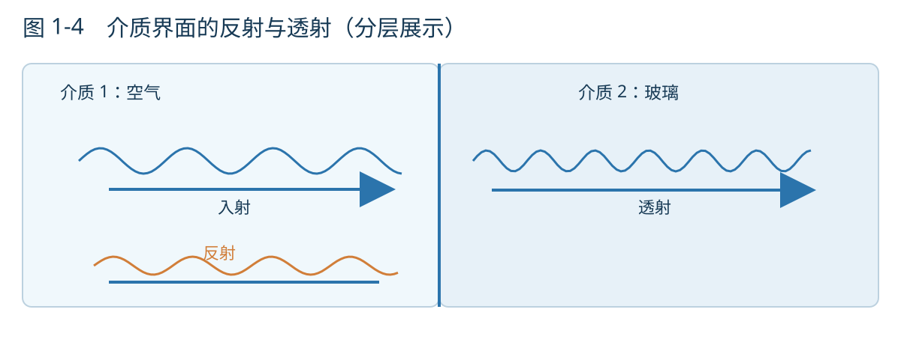
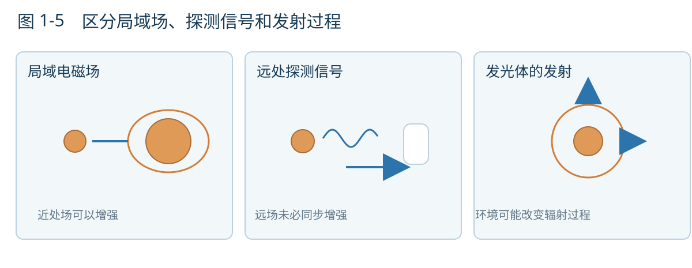

# 第一章　光与物质的第一次相遇

> **本章的约定。** 我们先把光看成经典电磁场，并假设存在一个很小、发出近似单色光的光源。它可以是实验上用来模拟发光体的天线，也可以暂时代表一个实际的微小发光体。这个假想光源的频率、位置和辐射强度由我们指定。现实中的原子、荧光分子和激光器并不完全符合这种理想化设定；当研究环境反过来影响发射过程时，我们将修正它。本章的示意图均为**概念模型**，不表示精确计算得到的电磁场分布。

## 1.1　把同一个光源放进四个世界

设想我们有一个微小光源，放在实验台中央。我们可以选择它发出的光的频率，也可以指定它的振荡方向。离光源较远的位置放置一个探测器，测量到达那里的光。暂时不必追究光源内部究竟怎样发光，只要求在每一次比较中，它本身保持不变。

现在依次改变光源周围的环境。

第一次，实验台上只有光源，周围近似为真空。光向外传播，远处的探测器收到信号。第二次，在光源与探测器之间放入一块透明玻璃。多数光仍然能够到达探测器，但传播的相位会改变，而且有一小部分光被反射。第三次，将玻璃换成一块金属板，光的反射和吸收通常变得显著。第四次，拿走金属板，在光源附近放置一颗尺寸远小于光的波长的金属纳米颗粒。我们也许会发现，在颗粒附近很小的区域内，电磁场比没有颗粒时强得多。

**图1-1｜同一个光源，四种环境。** 图中的波纹和光路只用于指出传播方向、界面和局部场的位置；金属颗粒周围的曲线不是电磁场的数值解。各图的探测条件也只是示意，不能据此比较真实的绝对强度。

这四次实验中，我们始终谈论同一种光。发生变化的是光所处的环境。因此，单凭“光沿直线传播”或者“光有某种确定波长”，已经不足以回答全部问题。我们还需要知道，物质如何响应光、界面如何使场重新分布，以及微小结构为何能够产生很强的局域响应。

这里先留下一个问题：如果第四次实验中，探测器接收到的光并没有显著增强，我们是否就能断定纳米颗粒附近也没有场增强？答案是否定的。局部的场与传播到远处的场是不同的观察对象。以后我们还会反复碰到这种区别。

## 1.2　我们究竟用什么描述光？

日常语言常把光描述为“一条光线”。在镜子、透镜或宏观光路中，这是一种方便而有效的近似。可是，光线本身没有足够的信息来描述偏振、干涉，或者纳米颗粒附近的电磁场。为了回答本章提出的问题，我们需要回到电场与磁场。

在经典电磁理论中，每个空间位置、每个时刻都可以对应一个电场 $\mathbf E(\mathbf r,t)$ 和一个磁感应强度 $\mathbf B(\mathbf r,t)$。它们不是两张互不相关的地图：随时间变化的电场与磁场，通过 Maxwell 方程相互联系。在真空中并且研究区域内没有电荷和电流时，方程写成

$$
\begin{aligned}
\nabla\cdot\mathbf E &=0, & \nabla\cdot\mathbf B &=0,\\
\nabla\times\mathbf E &=-\frac{\partial\mathbf B}{\partial t}, &
\nabla\times\mathbf B &=\mu_0\varepsilon_0\frac{\partial\mathbf E}{\partial t}.
\end{aligned}
\tag{1.1}
$$

这四个式子并不要求读者此刻熟记每一种微分运算。散度 $\nabla\cdot$ 描述某个位置附近场的流出特征，旋度 $\nabla\times$ 描述局部环绕变化；本章实际用到的运算很少。更重要的是认识到：这是一套同时规定场的空间变化与时间变化的方程。

让我们只做一段有物理意义的推导。对 Faraday 定律两边再取一次旋度，并用另一条 Maxwell 方程消去 $\mathbf B$，得到

$$
\nabla\times(\nabla\times\mathbf E)
=-\mu_0\varepsilon_0\frac{\partial^2\mathbf E}{\partial t^2}.
\tag{1.2}
$$

利用恒等式 $\nabla\times(\nabla\times\mathbf E)=\nabla(\nabla\cdot\mathbf E)-\nabla^2\mathbf E$，再用 $\nabla\cdot\mathbf E=0$，便得到

$$
\nabla^2\mathbf E-\frac{1}{c^2}\frac{\partial^2\mathbf E}{\partial t^2}=0,
\qquad c=\frac{1}{\sqrt{\mu_0\varepsilon_0}}.
\tag{1.3}
$$

磁场也满足同类的波动方程。这个结果告诉我们：即使没有物质充当机械媒介，真空中的电磁场也允许以速度 $c$ 传播的波动。Maxwell 方程并没有把电场与磁场简单地当作两个彼此独立的振子；它们作为同一电磁波解的组成部分，具有确定的相互关系。

最容易研究的解是平面波：

$$
\mathbf E(\mathbf r,t)=\operatorname{Re}\left[\mathbf E_0e^{i(\mathbf k\cdot\mathbf r-\omega t)}\right].
\tag{1.4}
$$

这里 $\mathbf k$ 指出相位前进的方向，它的大小在真空中满足 $|\mathbf k|=\omega/c$；$\omega$ 是角频率，$\mathbf E_0$ 包含电场的振幅和偏振信息。将这个解代回 Maxwell 方程，还可以得到

$$
\mathbf k\cdot\mathbf E_0=0,
\qquad \mathbf B_0=\frac{1}{\omega}\mathbf k\times\mathbf E_0.
\tag{1.5}
$$

也就是说，对于真空中这种理想平面波，电场垂直于传播方向，磁场与电场、传播方向也相互垂直。注意，这个结论在此处针对**无源真空中的平面波**；当光源附近存在明显的近场分量时，不能把每个位置的场都画成这样一组三个互相垂直的箭头。

**图1-2｜从光线到场。** 箭头示意 $\mathbf k$、$\mathbf E$ 与 $\mathbf B$ 的空间方向关系，并不逐点表示图中波形的瞬时数值。竖直虚线象征相位面；它不是瞬时电场强度的等值线。图示只针对理想平面波。

平面波便于计算，却不能完整代表一个有限尺寸光源的辐射。对三维空间中的局域光源，远场的场振幅通常随距离近似按 $1/r$ 衰减，能流密度因而近似按 $1/r^2$ 衰减；只有进入远场区域之后，我们才能在局部把它近似看作平面波。这个区别会在后面的成像与近场光学中再次出现。

**思想实验一｜把光源和探测器拉得更远。** 如果真空中的同一个局域光源始终发出相同的总功率，为什么探测器接收到的光通常会随距离增加而减弱？把一个球面的半径扩大两倍，它的面积增加到四倍，而穿过整个球面的总功率并未因此变成四倍。这个解释已经能让我们预期远场的 $1/r^2$ 行为。但是它并不适合直接计算紧贴光源的局部电场——那里还可能有不同距离依赖的场分量。

## 1.3　玻璃为什么能够改变光？

回到第二次实验。一束光通过一块玻璃，出射光的相位与没有玻璃时不同。我们习惯用折射率 $n$ 描述这种效应，但一个符号尚未回答“玻璃为什么会有折射率”。

可以先用一个非常粗糙的微观模型：把材料中的某个束缚电子想象成被弹性力量拉回平衡位置的带电振子。外部电场作用于电子，使它发生微小位移；电子的位移又改变了局部电荷分布。大量原子或分子共同响应，就形成材料的宏观极化。

**图1-3｜Lorentz 振子模型。** 图中弹簧和可位移的小球只是说明回复力与受迫振动的类比，并不表示电子真的通过机械弹簧连接原子核。真实材料的能级、电子云、相互作用和局部电场均比此模型复杂。

我们暂时在一个方向上写出振子的运动方程：

$$
m\ddot x+m\gamma\dot x+m\omega_0^2x=-eE(t).
\tag{1.6}
$$

$-e$ 是电子电荷，$\omega_0$ 是模型中的固有角频率，$\gamma$ 表示阻尼。对于随时间按 $e^{-i\omega t}$ 振荡的电场，稳态位移也以相同频率响应，只是振幅和相位可以不同。如果单位体积内有 $N$ 个这样的振子，极化强度 $P=-Nex$。代入方程便得到一个频率依赖的响应关系：

$$
P(\omega)=\varepsilon_0\chi(\omega)E(\omega),
\qquad
\chi(\omega)=\frac{Ne^2}{\varepsilon_0m}\,
\frac{1}{\omega_0^2-\omega^2-i\gamma\omega}.
\tag{1.7}
$$

不必急于记住这个分式。先观察分母：当驱动频率变化时，材料的响应大小会变化；靠近共振频率时，这种变化可能特别明显。阻尼使响应具有与驱动力不同的相位，并且与能量耗散相联系。于是，“同一块材料对所有颜色的光都作出相同响应”这一想法就不再成立。

在线性、各向同性、非磁性介质的简单描述下，可以写成 $\varepsilon_r(\omega)=1+\chi(\omega)$，复折射率满足 $\tilde n^{\,2}\simeq\varepsilon_r$。其实际适用条件与更严格的电磁介质理论，将在后面的章节补充。这里先看到两个重要事实：**折射率来自物质对电磁场的响应，而这种响应依赖频率，也可能包含损耗。** 玻璃在可见光区比较透明，并不表示其中电子完全不受光影响。

**思想实验二｜如果材料内部没有任何电磁响应。** 假设有一种假想物质，外加光场不会在其中诱导额外的极化或磁化，而且它的电磁参数与真空完全相同。将它制成一块平板，能仅凭“这里有一块东西”就让光发生通常意义上的界面反射吗？在这个模型里不能。能够改变传播的，是材料与周围空间在电磁响应上的差别，而非我们给物体取的名称。

## 1.4　界面和几何形状也参与决定结果

知道玻璃的折射率，还不能完全确定一束光通过玻璃板之后会发生什么。我们必须知道玻璃如何放置、表面在哪里，以及光从哪个方向照射。

一条重要的线索是边界条件：在没有额外表面电流等特殊条件时，电场和磁场强度的切向分量在通常的介质界面上满足相应的连续性条件。入射波、反射波和透射波必须共同满足这些约束。对于法向入射、两侧为非磁性且无损耗的均匀介质，电场反射振幅系数为

$$
r=\frac{n_1-n_2}{n_1+n_2},
\qquad R=|r|^2.
\tag{1.8}
$$

例如，从空气近似垂直地照向折射率为 $1.5$ 的玻璃表面，单个界面的反射率约为 $4\%$。这并不妨碍玻璃本身在该波段具有较高的透光性；对于一块真实玻璃板，还要进一步考虑第二个界面和可能出现的多次反射。

**图1-4｜透明不等于不反射。** 为了使传播方向易于辨认，示意图将入射波、反射波与透射波分开画出。实际的平面波在同一空间区域叠加；箭头也不按能流的真实比例绘制。

换成金属时，材料对电磁场的响应与一般透明介质明显不同。一个有用的经典起点是 Drude 模型：把可移动的传导电子视作在电场驱动下运动，并受到有效阻尼。由此可得到频率依赖的复介电常数。在一定频率范围内，金属的介电常数实部可以为负，这会深刻改变光在金属内部以及金属表面附近的分布。

但“金属会反射光”还不能直接推出所有金属结构都以同样方式反射，也不能推出所有纳米颗粒都会增强局域电场。材料的频率响应、结构大小与形状，以及周围介质，都会影响结果。

现在把金属板缩小成一颗球形纳米颗粒。如果颗粒半径 $a$ 远小于环境中的波长，我们可以在一定条件下暂时忽略颗粒内部电磁场的传播相位差，把它近似看成受外部光场驱动的电偶极子。对于均匀、各向同性的球形颗粒，其准静态极化率具有如下结构：

$$
\alpha=4\pi\varepsilon_0\varepsilon_d a^3
\frac{\varepsilon_m-\varepsilon_d}{\varepsilon_m+2\varepsilon_d}.
\tag{1.9}
$$

这里 $\varepsilon_m$ 与 $\varepsilon_d$ 分别是金属和周围介质的相对介电常数，且采用 $\mathbf p=\alpha\mathbf E_{\mathrm{ext}}$ 的定义。现在无需推导这个公式；它在后面的 Plasmonics 章节才会成为主要对象。此处只留意两个方面：颗粒的几何尺寸以 $a^3$ 的形式出现，而材料与环境的介电响应通过分式共同决定诱导偶极子的强弱。在低损耗的适当条件下，分母接近零意味着强烈的共振响应；实际响应还受到吸收、辐射损耗以及准静态近似适用范围的限制。

**思想实验三｜只改变颗粒的周围介质。** 假设金属颗粒的材料、大小和形状都不变，我们将它从空气移入另一种透明液体。它的局域共振频率一定保持不变吗？从式（1.9）可以看出，周围环境的 $\varepsilon_d$ 参与了颗粒的响应。因此，即使我们没有加工颗粒本身，光学性质仍然可能发生变化。这也是为什么纳米光学研究不能只讨论“器件是什么材料”，还要讨论器件置于什么环境中。

## 1.5　改变的是光的路径，还是光源本身？

前面四次实验都假定光源本身不受环境影响。这是方便我们拆解问题的一种约定，但它并不总是成立。

如果光源是一根由外部电源维持确定电流的天线，我们可以先把电流当作给定条件，计算不同环境中的辐射与散射。但是，对于实际的原子、荧光分子或其他微观发射体，附近的电磁环境也可能影响它释放能量的方式与速率。把这样的发光体放在镜子、波导、共振腔或金属纳米天线附近，改变的就可能不仅是“原来发出的光经过哪里”，还包括发光体向不同电磁模式耦合的能力。

**图1-5｜三个不能混为一谈的量。** 左侧是环境给光源附近带来的局部场变化，中间是远处探测器接收的信号，右侧是发光体的发射过程本身。示意箭头表示可能的影响关系，不代表在所有情形下它们都会同时增强。实际发光还涉及内禀非辐射衰减、激发条件和量子效率等因素。

这个区别对以后阅读纳米光学论文很有帮助。如果某篇论文报告了“荧光增强”，我们需要继续问：增强的是激发光的局部强度、发射速率、辐射效率、收集效率，还是最后探测到的光子数？它们可能相互影响，却不是同一个物理量。同样，“强局域场”也不能直接等同于“远场一定更亮”；能量可能被吸收为热，或者耦合进探测器没有收集到的方向与模式。

我们以后会借助光学态密度、Green 函数、耦合模理论，以及必要的量子描述，更准确地讨论这些问题。不过现在已经可以形成一种工作习惯：**在比较两个光学系统之前，先明确保持了什么不变、改变了什么，以及我们究竟测量哪个量。**

## 1.6　本章留下的工具

本章从一个微小光源出发，依次让它面对真空、透明介质、金属界面和金属纳米颗粒。我们没有试图把这些问题全部解完。相反，我们让几个简单模型分别承担了不同任务。

Maxwell 方程告诉我们，电磁波是电场与磁场共同满足的一类动力学解；Lorentz 振子模型告诉我们，材料的折射率、色散和吸收可以从电磁响应出发理解；边界条件说明，材料的空间排列方式也会改变电磁场；纳米颗粒则提醒我们，结构远小于波长时，仍然可能出现显著的局域响应。

这几个模型所处理的对象，既有相同之处，也有不能随意混用的条件。把电磁场画成沿直线传播的光线，适合一些宏观光路，却不足以理解近场；把玻璃里的电子画成小球与弹簧，可以帮助我们认识频率响应，却不能取代真实的量子材料理论；把纳米颗粒视作偶极子，也只在一定尺寸与频率条件下有效。使用简化模型时，既要知道它为什么有用，也要知道它在哪里结束。

在之后的章节中，我们会让这个光源继续旅行：经过两条可能相互干涉的路径，进入一条波导，被放入一个光学共振腔，靠近一面金属表面，最终成为一个与纳米结构发生耦合的微观发光体。每次引入新条件，我们都会重复同样的几个问题：**哪些物理量保持不变？电磁场被允许以哪些方式存在？能量最终流向哪里？实验实际能够测到什么？**

下一章将更系统地讨论电磁波的振幅、相位、偏振、能量与叠加。我们会看到，为什么一个看起来非常简单的相位差，已经足以成为干涉、成像和光学控制的共同语言。

---

### 本章的三个自检问题

1. 如果某块材料的折射率恰好与环境相同，是否意味着它在任何情况下都完全不可见？请列出这一判断还隐含了哪些关于吸收、散射、材料均匀性与界面的假设。
2. 如果探测器在远处测到的光强变大，能否据此断言光源自身的发射速率增大？尝试给出至少两种不同的解释。
3. 将一个金属纳米颗粒不断缩小，式（1.9）是否意味着局域场增强会无限增加？为什么不能仅仅根据公式分母来作判断？
