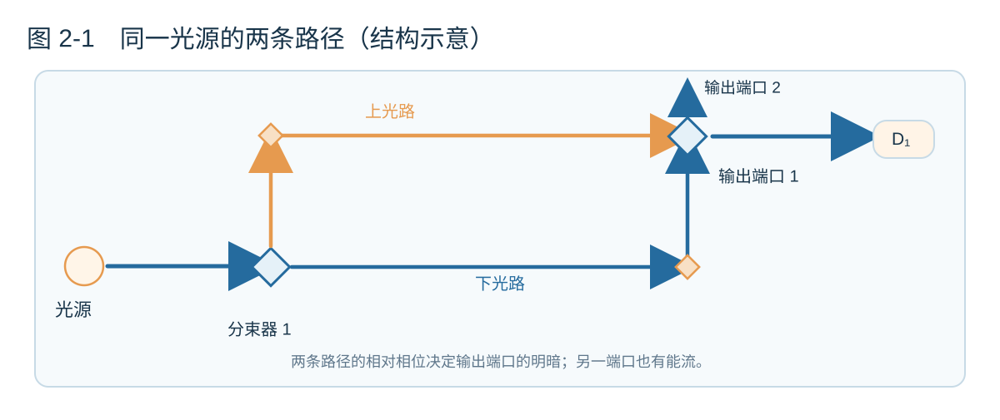
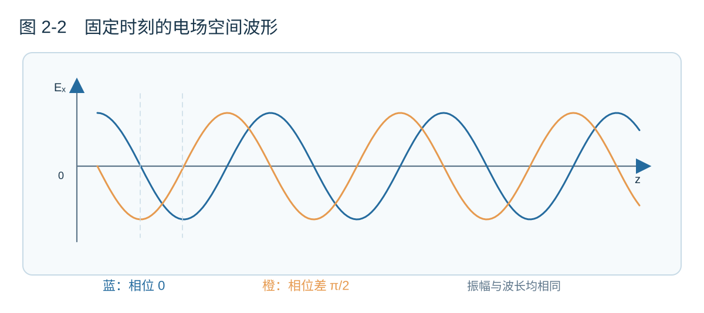
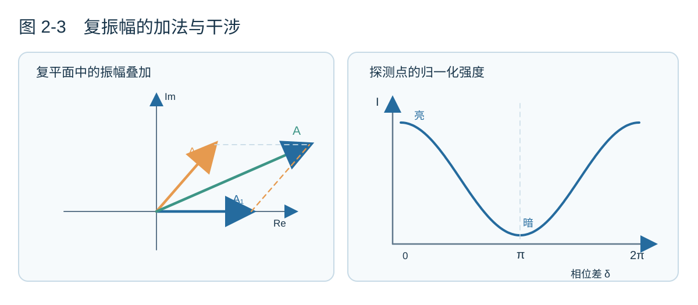
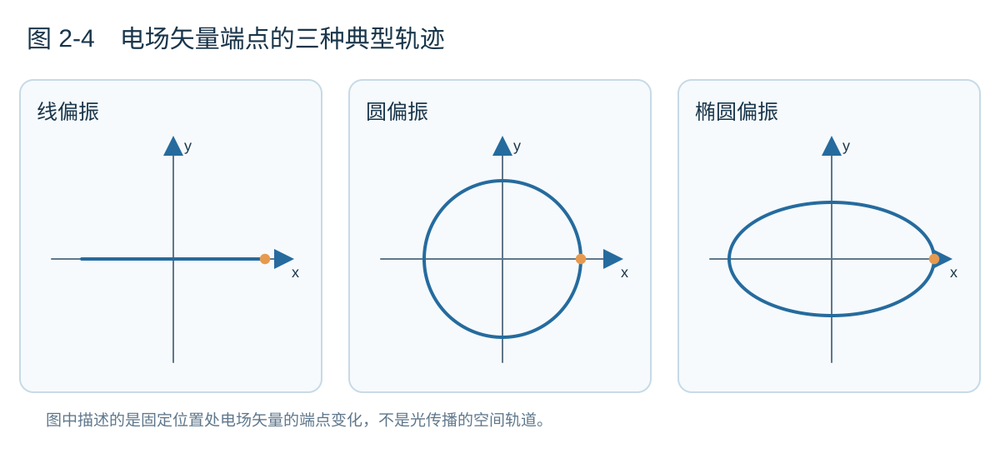
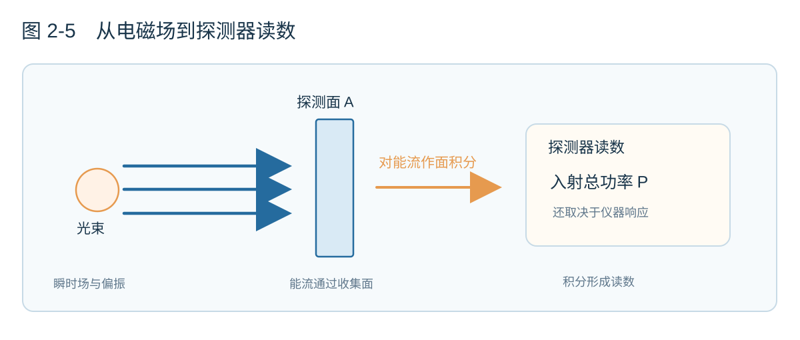
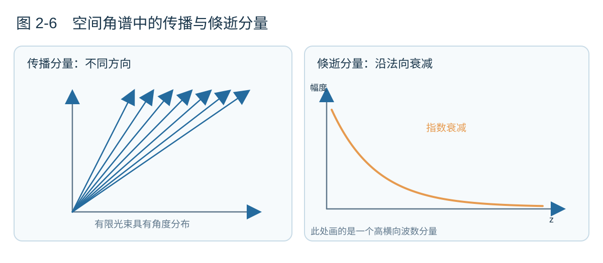

# 第二章　波的语言：相位、偏振与能量

> **本章的模型。** 延续第一章的假想光源，我们先把它发出的光看成近似单色的经典电磁波。为便于分析，可以从光源辐射的一个小角度范围中取得光，再通过准直系统使它近似为平面波。本章多数实验先采用线性、稳定、无明显损耗的光学元件；后面会逐渐放宽这些条件。所有示意图都属于**简化物理模型**，用来表现变量之间的关系，并非精确计算出的场分布。

## 2.1　两条路汇合以后，为什么会更暗？

上一章我们让光源分别面对真空、玻璃、金属板和纳米颗粒。这一章暂时不更换材料，只改变光抵达探测器的方式。

让一束光进入分束器，分成两路。两路光分别经过反射镜，最后在第二个分束器处重新汇合。图2-1给出类似 Mach–Zehnder 干涉仪的结构。在某个输出端口设置探测器，记录接收到的光功率。

**图2-1｜双光路思想实验。** 这是光路连接关系示意；真正的分束器还会赋予不同输出一定的相位变化。能量守恒需要同时考虑所有输出端口，不能只观察其中一个探测器。

如果挡住其中一条路，探测器能够收到光；挡住另一条、只开放刚才那一路，同样能够收到光。然而，两条光路同时打开以后，探测器未必更亮。微小地改变其中一条光路的长度，信号甚至可能接近零；继续移动，又会恢复明亮。

这是个值得保留的问题：既然两条路分别携带光能，为什么汇合时反而可能变暗？

原因在于需要相加的量是**电磁场**，不是两次探测器读数。电场可以有正负变化，也有相位。电磁场叠加以后，探测器再把场转换成平均能量信号；这两个步骤不能交换次序。本章将建立解释这件事情的基本语言。

**思想实验一｜打开与关闭。** 分别记录两条光路的单路信号，再同时打开。请先想想，哪些条件下两次单路读数能够直接相加？哪些条件下你必须知道两路光的相对相位？这个问题将在第三节得到明确的数学表达。

## 2.2　振幅、频率和相位：怎样描述一束波？

第一章已经从 Maxwell 方程得到真空电磁波方程。取最简单的情形：光沿 $z$ 方向传播，电场沿 $x$ 方向振动。它可以写为

$$
\mathbf E(z,t)=\hat{\mathbf x}E_0\cos(kz-\omega t+\phi_0).
\tag{2.1}
$$

$E_0$ 是电场振幅；$\omega$ 决定在一个固定位置上电场振动的快慢；$k$ 决定在一个固定时刻上，电场随空间位置变化的快慢。$\phi_0$ 是初始相位，取决于参考时间和参考位置的选择。

$$
\omega=2\pi f,\qquad
k=\frac{2\pi}{\lambda},\qquad
v_{\mathrm p}=\frac{\omega}{k}.
\tag{2.2}
$$

在真空中，相速度 $v_{\mathrm p}=c$。对于均匀、透明的普通非磁性介质，在某一频率处一般有 $k=n(\omega)\omega/c$。相速度是固定相位的位置移动的速度，不能一概当作信息传递的速度；等我们讨论含多种频率的波包，还会遇到群速度。

**图2-2｜固定时刻的空间波形。** 两条曲线有相同振幅与波长，只是相位不同。它们表示电场的某个分量沿空间位置的变化，绝不意味着一束光本身沿曲线蜿蜒前进。

相位并非只用于修饰公式。假如两个频率相同的场分量在同一个位置分别是 $E_0\cos\theta$ 和 $E_0\cos(\theta+\delta)$，它们的相位差 $\delta$ 决定合成场能有多大。这里要区分**绝对相位**与**相对相位**：统一改变时间原点，不会改变实验结果；只改变其中一条路径经历的相位，才能改变干涉的明暗。

以波长 $600\ \mathrm{nm}$ 的真空光为例，频率约为 $5\times10^{14}\ \mathrm{Hz}$，振荡周期约 $2\times10^{-15}\ \mathrm{s}$。普通直接光电探测器无法逐周期报告光学电场的正负号，通常得到的是经过时间平均的响应。这也是为什么一个稳定的功率读数并没有告诉我们场的相位。

## 2.3　复振幅不是虚构的光

处理许多波时，逐个展开余弦函数很不方便。我们可以用复数来记录振幅与相位：

$$
E(z,t)=\operatorname{Re}\left[\tilde E(z)e^{-i\omega t}\right],
\qquad
\tilde E(z)=E_0e^{i(kz+\phi_0)}.
\tag{2.3}
$$

$\tilde E$ 称为**复振幅**。真实的电场仍是取实部之后的物理量；复数只是使叠加运算更简洁的表示。在复平面中，一根箭头的长度代表振幅，它的方向角代表相位。两个同频率的标量场分量，可以像矢量那样相加。

**图2-3｜相位决定合成结果。** 左边箭头位于复数平面，不表示电场在真实空间中的运动轨迹；右边表示理想情况下单点归一化探测强度如何随相对相位变化。

若两束同频率的复标量场分量为 $A_1$ 和 $A_2$，叠加后的场为 $A=A_1+A_2$，因此

$$
|A|^2=|A_1|^2+|A_2|^2+
2\operatorname{Re}(A_1A_2^*).
\tag{2.4}
$$

假定两束光在探测位置的频率相同、偏振一致，而且相对相位 $\delta$ 稳定。各自单独照射时产生的强度记为 $I_1,I_2$，同时照射时便有

$$
I=I_1+I_2+2\sqrt{I_1I_2}\cos\delta.
\tag{2.5}
$$

第三项是干涉项。如果 $I_1=I_2=I_0$，当 $\delta=0$ 时，局部强度为 $4I_0$；当 $\delta=\pi$ 时，则为零。这里比较的是**同一个探测位置的强度**。一台被动、无损光学仪器不会因此产生或消灭总能量。在理想双输出的干涉仪中，一个端口变暗，另一个端口会相应变亮；空间中的干涉也可能使能量重新分布。不能只测量一个亮点，就断定整个系统的输出功率增加了。

**思想实验二｜移动一面镜子。** 如果一条光路中的某段光线走向镜子、反射后再沿原路返回，把这面镜子沿入射方向移动 $\Delta x$，光程大约改变 $2\Delta x$，因而相位改变 $2k\Delta x$。镜子移动介质中的半个波长，就会带来 $2\pi$ 的相位变化。若光只沿可移动部分单程传播，光程变化就不再有这个因子 $2$。因此，不能脱离具体光路机械使用“移动一个波长”的说法。

### 相干性：有两束波，还要有稳定的相位关系

式（2.5）暗含一个条件：相对相位在观测过程中足够稳定。如果两束光的相位差在探测器的积分时间里不断无序变化，那么平均干涉项可能趋近于零，信号就接近 $I_1+I_2$。

这引出**相干性**的概念。它描述光场之间的相关程度，受到光谱宽度、路径延迟、环境漂移及测量时间等因素影响。激光往往具有适合长光程差实验的时间相干性；宽谱光源仍然能够干涉，但通常只在比较有限的光程差内形成明显条纹。把“能否干涉”简单归结为“是不是激光”，会错过背后的物理条件。

## 2.4　偏振：电场不只有一个方向

前面为了方便，把电场写成沿 $x$ 方向变化的量。真实电场是矢量。对于沿 $z$ 方向传播的理想真空平面波，电场可以在横向 $x$–$y$ 平面内变化。令两个正交分量的非负实振幅为 $E_x,E_y$，相对相位为 $\delta$，则

$$
\mathbf E(z,t)=\operatorname{Re}\left[
\big(E_x\hat{\mathbf x}+E_ye^{i\delta}\hat{\mathbf y}\big)
e^{i(kz-\omega t)}
\right].
\tag{2.6}
$$

它的复振幅可以用 **Jones 矢量**表示：

$$
\mathbf J=
\begin{pmatrix}E_x\\E_ye^{i\delta}\end{pmatrix}.
\tag{2.7}
$$

一个有用的具象问题是：固定在空间的一点，想象电场是一根不断变化的箭头，它的端点会画出什么形状？如果两分量同相或反相，端点沿直线往复运动，是线偏振；如果两分量振幅相等、相位差为 $\pm\pi/2$，端点沿圆周转动，是圆偏振；更一般的情形形成椭圆偏振。圆偏振的左右旋称呼依赖观测方向与符号约定，本章先使用明确的相位关系。

**图2-4｜固定位置处电场矢量端点的轨迹。** 图中的横纵轴表示两个电场分量，不是电子轨迹，也不是光前进的实际路径。

把一个理想线偏振片放到光源前面。若原本线偏振的电场方向与偏振片透过轴夹角为 $\theta$，透射场沿该轴的振幅变成原来的 $\cos\theta$ 倍，而强度为

$$
I_{\mathrm{out}}=I_{\mathrm{in}}\cos^2\theta.
\tag{2.8}
$$

这就是 Malus 定律。对于理想非偏振光，经第一块理想线偏振片后，平均透射强度约为一半；它不能简单地被当成一束具有固定 Jones 矢量的纯偏振光。

**思想实验三｜互相垂直的两束光。** 假设两束相干光在同一点重合，一束沿 $x$ 偏振，另一束沿 $y$ 偏振。若探测器同等接收两个正交分量，它们总强度中的交叉干涉项为零。现在在探测器前加一块透过轴与 $x$ 方向成 $45^\circ$ 的偏振片，情况会怎样？两个分量被投影到同一个方向；只要原先存在稳定的相位关系，测得的强度便可能重新出现干涉。偏振片不会凭空创造原本不存在的相干性，它只改变了被测量的场分量。

今后讨论具有方向性的光学天线、发光体跃迁偶极矩和波导模式时，“场有多强”与“场朝哪个方向振动”会成为两个不能混淆的问题。

## 2.5　能量与测量：亮度到底意味着什么？

光电探测器给我们的通常是电信号，不是完整的瞬时电磁场。要讨论它的读数，先要知道电磁场的能量怎样在空间中流动。

真空中电磁能量密度 $u$ 和 **Poynting 矢量** $\mathbf S$ 为

$$
u=\frac12\left(\varepsilon_0 E^2+\frac{B^2}{\mu_0}\right),
\qquad
\mathbf S=\frac{1}{\mu_0}\mathbf E\times\mathbf B.
\tag{2.9}
$$

$\mathbf S$ 的单位是 $\mathrm{W/m^2}$，描述能量流经过单位面积的速率与方向。由 Maxwell 方程还能得到局域守恒关系

$$
\frac{\partial u}{\partial t}+\nabla\cdot\mathbf S
=-\mathbf J\cdot\mathbf E.
\tag{2.10}
$$

右端表示场对电流做功。当研究区域没有电流时，电磁场能量在该区域的变化来自流入和流出边界的能量。我们在第三节遇到的干涉明暗，不应与能量被凭空消灭混为一谈。

对于均匀、透明、非磁性介质中的理想传播平面波，平均能流大小可写为

$$
I=\frac12 n\varepsilon_0c\,|\tilde{\mathbf E}_0|^2.
\tag{2.11}
$$

这里 $\tilde{\mathbf E}_0$ 是峰值复电场振幅。式（2.11）不适合直接套用于任意叠加场、驻波或复杂近场；宏观介质中更一般的能流是 $\mathbf E\times\mathbf H$，而在色散或吸收介质中讨论储能还需要额外谨慎。

若探测器的收集面是 $A$，表面法向 $\hat{\mathbf n}$，在忽略实际探测器的响应损耗等因素时，入射总功率为

$$
P_{\mathrm{inc}}=
\int_A\langle\mathbf S\rangle\cdot\hat{\mathbf n}\,dA.
\tag{2.12}
$$

**图2-5｜电场、能流密度与探测功率属于不同层次。** 光束本身可以具有空间变化的强度分布，而探测器读数还与收集面积、方向和仪器响应有关。

**思想实验四｜同样的功率，不同的光斑。** 两束光总功率相等，一束形成很小的光斑，另一束分布在很大的区域。一个放在光斑中心的小探测器可能报告完全不同的信号，而一个完整收集所有入射光的大探测器得到的总功率却可以相同。因此，当论文说某种结构实现“光强增强”，要继续追问：增强的是局部电场、单位面积能流、辐射到某个方向的功率，还是最终探测到的光子数？它们经常联系在一起，但并不相同。

## 2.6　有限光束与空间频谱：从衍射走向近场

平面波沿横向无限延伸，却不能完全代表由有限孔径、波导出口或真实光源产生的光束。一个有限宽度的光束，为什么会随着传播逐渐发散？

这时 Fourier 分析非常有用。考虑均匀、无源、无损耗介质中，在 $y$ 方向不变的二维问题；对某个满足标量 Helmholtz 方程的偏振分量 $\tilde E_y(x,z)$，可以写出角谱分解

$$
\tilde E_y(x,z)=
\int_{-\infty}^{\infty}
A(k_x)e^{i(k_xx+k_zz)}\,dk_x,
\qquad k_x^2+k_z^2=k_0^2,
\tag{2.13}
$$

其中 $k_0=n\omega/c$，取朝 $z>0$ 的传播或衰减分支。一个横向局域的场需要许多不同的 $k_x$ 分量共同叠加。当 $|k_x|<k_0$ 时，$k_z$ 可以取实数；这些分量具有不同传播角度，传播中逐渐积累不同相位，导致光束横向展宽。对于理想近轴 Gaussian 光束，远场发散半角约为 $\theta\simeq\lambda_0/(\pi nw_0)$，这里 $w_0$ 是束腰处强度降至中心 $1/e^2$ 时的半径。这是一个具体模型的结果，并不是任意光束的普适公式。

当 $|k_x|>k_0$ 时，$k_z$ 具有正虚部，因而

$$
e^{ik_zz}=
e^{-\sqrt{k_x^2-k_0^2}\,z}.
\tag{2.14}
$$

这些分量沿远离界面或源的方向指数衰减，叫作**倏逝分量**。它们可以出现在光源或结构附近，却不能像普通传播平面波一样，将高横向空间频率的信息自由送往无限远处。

**图2-6｜传播与倏逝的区分。** 左图用不同方向的箭头示意传播分量；右图用曲线示意一个倏逝分量随距离衰减。图没有展示某个具体光束的计算结果，不能据此认定所有结构的角谱幅度相同。

这给后续章节埋下一个线索：衍射、有限光束的发散和近场成像，可以使用同一套空间频谱语言讨论。我们也应该避免一个错误推断：只要横向结构足够小，就必然产生任意强的倏逝场。具体场分布还由光源、边界条件和激发方式决定；Fourier 分解本身并不保证每个分量都具有显著幅度。

## 2.7　用四种改动回顾本章

把我们的光源放回实验台。现在我们可以提出四种不同的改动。

只改变一条相干光路的长度，主要改变两路光之间的相对相位；只旋转某一路的偏振，则可能改变两路场在探测器上能否形成交叉干涉项；在总功率近似不变时重新聚焦光束，可以增加某处的局部能流密度；把光源靠近亚波长结构，可能激发具有显著横向空间频率的局域场，而普通远场探测无法直接收集其中的全部信息。

这些变化使用不同的物理变量。相位变化不要求总能量变化；偏振变化不必伴随频率变化；远场探测器读数变大也不自动意味着光源自身发射速率变大。一个熟悉现代光学的研究者，在看到某个“增强”“抑制”或“控制”结论时，通常会先问：实验固定了什么、改变了什么，最后测量的又是什么？

接下来的章节会把波放进空间结构之中。我们将讨论介质界面怎样决定反射和透射，光程怎样影响干涉，衍射为何限制远场成像，以及从近场中获取空间信息需要付出怎样的代价。几何光学将在需要它的时候作为适当的波动近似出现，而不必先成为一套独立而庞杂的知识体系。

---

### 本章思考题

1. 两束单独测得强度都为 $I_0$ 的相干光，在哪些相对相位下合成强度分别为 $0$、$2I_0$、$4I_0$？若两束光相对相位随机变化，长时间积分后将得到什么？
2. 只有一个光电探测器报告信号变强。请列出至少三种不同的物理原因，并说明可以增加什么测量来区分它们。
3. 两束正交偏振的相干光为什么可能不显示总强度干涉？为什么一块 $45^\circ$ 偏振片能够改变这个结果？
4. 一个系统希望光场在横向极小尺度上高度局域，同时又希望它在均匀介质中长距离传播且几乎不发散。这两个要求可能有什么冲突？论证中哪些条件一旦改变，结论就需要重新考虑？

### 本章公式的适用范围

式（2.5）要求明确的频率、偏振和相干关系；式（2.8）针对理想线偏振片及线偏振入射；式（2.11）针对均匀透明介质中的理想平面传播波；式（2.13）–（2.14）采用二维均匀区域内的一个可标量化场分量。学习波导、各向异性材料、耗散介质和纳米近场时，我们会回到相应的完整矢量 Maxwell 方程。